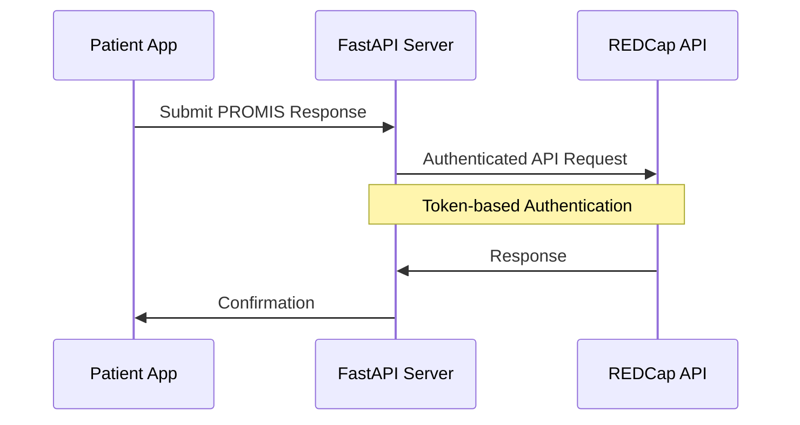

<<<<<<< HEAD
## REDCap Integration Implementation

### 1. Secure Token Management
We implement secure storage for REDCap authentication using Flutter's secure storage:

```dart
class SecureStorageService {
  static const _storage = FlutterSecureStorage();
  static const String _redcapToken = 'REDCAP_TOKEN';

  // Secure token retrieval
  static Future<String?> getRedcapToken() async {
    return await _storage.read(key: _redcapToken);
  }

  // Initialize REDCap token securely
  static Future<void> initializeApiKeys() async {
    final String? existingRedcapToken = await _storage.read(key: _redcapToken);
    if (existingRedcapToken == null) {
      final redcapToken = dotenv.env['REDCAP_TOKEN'] ?? '';
      if (redcapToken.isNotEmpty) {
        await _storage.write(key: _redcapToken, value: redcapToken);
      }
    }
  }
}
```

### 2. REDCap API Communication
Our FastAPI server handles secure communication with REDCap:

```python
from fastapi import FastAPI, HTTPException
from pydantic import BaseModel

class RedcapService:
    def __init__(self, api_url: str, token: str):
        self.api_url = api_url
        self.token = token

    async def get_form_metadata(self, form_name: str):
        data = {
            'token': self.token,
            'content': 'metadata',
            'format': 'json',
            'forms[0]': form_name
        }
        return await self._make_request(data)

    async def submit_responses(self, record_id: str, responses: dict):
        data = {
            'token': self.token,
            'content': 'record',
            'format': 'json',
            'type': 'flat',
            'data': json.dumps([{
                'record_id': record_id,
                **responses
            }])
        }
        return await self._make_request(data)
```

### 3. Data Flow Architecture



## Key Technical Features

### 1. Secure Authentication
- Token-based REDCap authentication
- Encrypted token storage
- Environment-based configuration

### 2. Data Handling
- Real-time form submission
- Secure response storage
- Error handling and validation

### 3. API Integration Points
- Form metadata retrieval
- Response submission
- Connection testing

## Current Implementation Status

### Completed Features
- ✅ Secure REDCap token management
- ✅ Form metadata retrieval
- ✅ Response submission
- ✅ Error handling

### In Progress
- 🔄 Offline support
- 🔄 Response validation
- 🔄 Enhanced error reporting

## Technical Dependencies

### Backend
- FastAPI
- Python REDCap API Client
- PostgreSQL (for local caching)

### Mobile App
- Flutter
- flutter_secure_storage
- dio (for HTTP requests)

## Security Measures

1. **Data Protection**
   - Encrypted token storage
   - Secure API communication
   - Local data encryption

2. **Authentication**
   - Token-based REDCap authentication
   - Secure token initialization
   - Regular token validation

## Next Steps

1. **Immediate Priority**
   - Complete offline support implementation
   - Enhance error handling
   - Add response validation

2. **Future Enhancements**
   - Implement real-time sync
   - Add advanced error recovery
   - Enhance performance monitoring

---

For detailed technical discussions or questions about the REDCap integration, please contact the development team.
=======
# Carepal-
HL7 FHIR based AI Assistant for Liver Cirrhosis Management
>>>>>>> 7219628b53eae8df40183dba83b17d0ec5894f27
