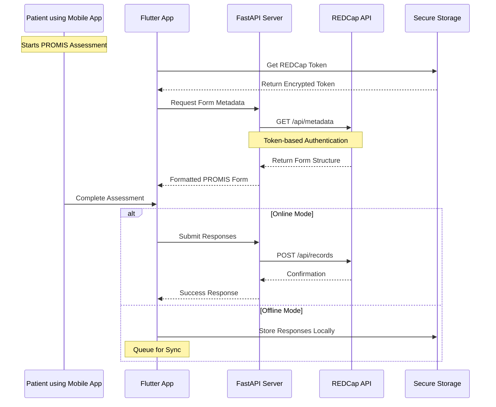

# Carepal — AI companion for liver-cirrhosis patients, grounded in HL7 FHIR and REDCap

[](https://flutter.dev)
[](https://fastapi.tiangolo.com)
[](https://ai.google.dev)
[](https://projectredcap.org)
[](https://hl7.org/fhir/R4/)
[](LICENSE)

> **Status:** research prototype (2024 – 2025), built during my MS in Health Informatics at Indiana University Indianapolis.
> Finalist, [2024 AMIA/HL7 FHIR App Competition](https://amia.org/education-events/amia-2024-annual-symposium/fhir-app)
> (AMIA 2024 Annual Symposium, San Francisco) as *Carepal for SMART Liver*.
> Carepal's ideas continue in **Mitra Health**, a privacy-first successor that runs MedGemma on-device.
> **Not a medical device; not for clinical use.**

Carepal is a patient-facing mobile app for people living with liver cirrhosis. It pairs an LLM assistant with
validated patient-reported outcome measures (PROMIS) and the interoperability plumbing (HL7 FHIR, REDCap) needed to
move what the patient reports back to the care team.

## What's inside

| Capability | Where | Notes |
|---|---|---|
| **AI assistant "Vik"** | `lib/chatbot/` | Gemini 2.0 Flash via `google_generative_ai`. A structured system prompt enforces plain-language answers, a safety reminder, and a *provider-ready conversation summary* the patient can bring to their next visit. |
| **Patient-reported outcomes** | `lib/redcap/`, `lib/screens/promis29_screen.dart` | PROMIS-29 profile (physical function, anxiety, depression, fatigue, sleep disturbance, social participation, pain interference, pain intensity) plus the cognitive-function short form. Form metadata is pulled from REDCap and responses are written back, with an offline queue. |
| **REDCap proxy API** | `api/` | FastAPI service exposing `GET /forms/metadata` and `POST /forms/submit`, keeping the REDCap token off the device. `lib/redcap/backend/` holds the earlier standalone iteration of the same service. |
| **Care-management screens** | `lib/screens/` | Medications, appointments, progress, health report, hospital info, cirrhosis education (articles, infographics, videos, webinars), notifications, settings. |
| **Secrets handling** | `lib/config/env.dart`, `lib/services/secure_storage_service.dart` | API keys are read from `.env` on first run and then kept in platform secure storage (`flutter_secure_storage`). |

FHIR connectivity for the Carepal project is prototyped in two companion repos:
[`hapi_flutter`](https://github.com/supermax01/hapi_flutter) (HAPI FHIR `Patient/$everything`) and
[`carepal-emr`](https://github.com/supermax01/carepal-emr) (OpenEMR SMART-on-FHIR, OAuth 2.0 + PKCE).

## Architecture

```
┌──────────────────────┐  PROMIS metadata / responses  ┌──────────────────┐   REDCap API   ┌──────────┐
│  Flutter app         │ ────────────────────────────▶ │  FastAPI  (api/) │ ─────────────▶ │  REDCap  │
│  iOS · Android ·     │                               └──────────────────┘                └──────────┘
│  Web · Desktop       │  chat (google_generative_ai)  ┌──────────────────┐
│                      │ ────────────────────────────▶ │ Gemini 2.0 Flash │
└──────────────────────┘                               └──────────────────┘
```

### REDCap data flow



## Running it

### 1. REDCap proxy API

```bash
cd api
python -m venv .venv && source .venv/bin/activate
pip install -r requirements.txt
# create api/.env with REDCAP_API_URL and REDCAP_API_KEY (see api/README.md)
uvicorn app.main:app --reload        # Swagger UI at http://localhost:8000/docs
```

### 2. Flutter app

```bash
cp .env.example .env                 # GEMINI_API_KEY, REDCAP_TOKEN, BACKEND_URL, ...
flutter pub get
flutter run
```

## Safety and privacy

- The assistant is constrained to general education, adds safety reminders, and produces summaries *for discussion
  with a clinician*. It does not diagnose, dose, or replace care.
- No patient data ships with the repository. REDCap tokens and model keys live in `.env` / secure storage only.
- PROMIS instruments are provided by HealthMeasures under their terms of use.

## Related repositories

| Repo | Role in the project |
|---|---|
| [hapi_flutter](https://github.com/supermax01/hapi_flutter) | FHIR `Patient/$everything` demo against a HAPI FHIR server |
| [carepal-emr](https://github.com/supermax01/carepal-emr) | OpenEMR SMART-on-FHIR client (OAuth 2.0 + PKCE) with a FastAPI proxy |
| [carepal-chatbot](https://github.com/supermax01/carepal-chatbot) | First Gemini chatbot prototype (2024) |
| [MediRAG](https://github.com/supermax01/MediRAG) | Local retrieval-augmented generation for medical question answering |

## License

MIT — see [LICENSE](LICENSE).
