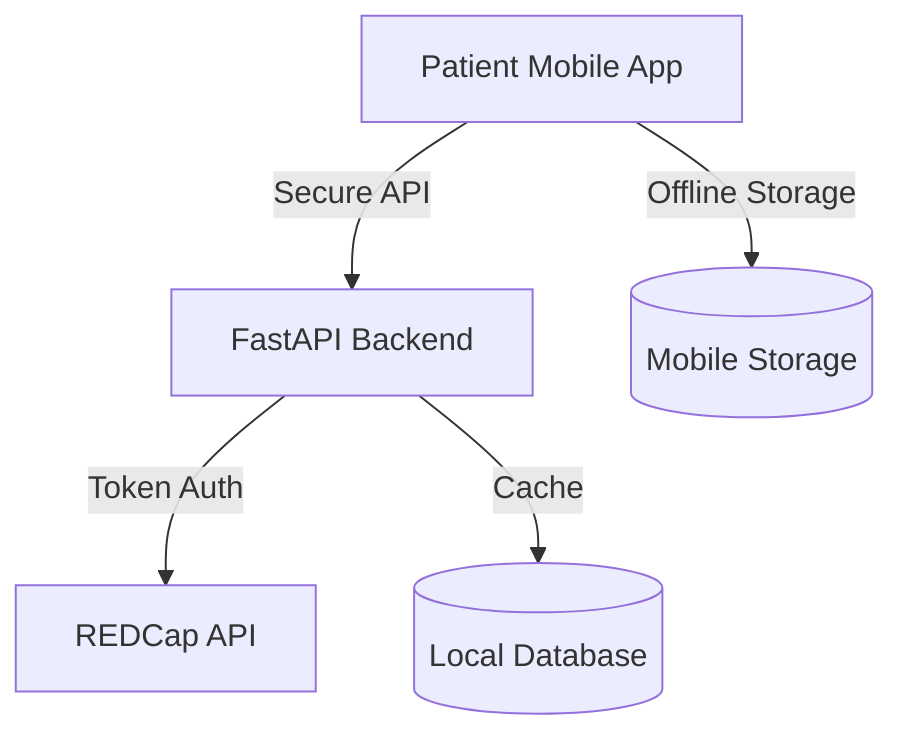

# CarePal: Mobile PROMIS Assessment Platform

> A secure, mobile-first solution for patient-reported outcomes integrated with REDCap

## 🌟 Overview

CarePal transforms traditional paper-based PROMIS (Patient-Reported Outcomes Measurement Information System) assessments into a modern digital experience. Built with Flutter and FastAPI, it enables patients to complete health assessments directly from their smartphones while ensuring secure integration with REDCap.

## 🏗️ Architecture



## 🚀 Key Features

- **Mobile-First PROMIS Forms**
  - Intuitive user interface
  - Offline support
  - Real-time validation
  - Multi-language support

- **Secure REDCap Integration**
  - Token-based authentication
  - Encrypted data transmission
  - Automatic synchronization
  - Error recovery

- **Advanced Security**
  - Environment-based configuration
  - Secure token storage
  - Data encryption
  - HIPAA compliance measures

## 🛠️ Technical Stack

### Frontend (Flutter)
- State Management: Bloc Pattern
- Secure Storage: flutter_secure_storage
- API Client: dio with interceptors
- Offline Support: Hive

### Backend (FastAPI)
- REDCap Integration Service
- Token Management
- Response Validation
- Error Handling

## 📋 Prerequisites

- Flutter SDK
- Python 3.8+
- REDCap API Access
- Virtual Environment

## 🔧 Setup

1. **Clone the Repository**
   ```bash
   git clone https://github.com/yourusername/carepal.git
   cd carepal
   ```

2. **Frontend Setup**
   ```bash
   flutter pub get
   cp .env.example .env  # Configure your environment variables
   ```

3. **Backend Setup**
   ```bash
   cd backend
   python -m venv venv
   source venv/bin/activate  # On Windows: venv\Scripts\activate
   pip install -r requirements.txt
   ```

## 🚦 Running the Application

1. **Start the Backend**
   ```bash
   cd backend
   uvicorn app.main:app --reload --port 8000
   ```

2. **Run the Flutter App**
   ```bash
   flutter run
   ```

## 🔐 Security Notes

- Never commit `.env` files
- Keep REDCap tokens secure
- Use environment-specific configurations
- Follow HIPAA compliance guidelines

## 📱 Features in Development

- [ ] Advanced offline synchronization
- [ ] Real-time form analytics
- [ ] Enhanced error recovery
- [ ] Multi-site support


## 📄 License

This project is proprietary and confidential. Unauthorized copying, modification, distribution, or use is strictly prohibited.